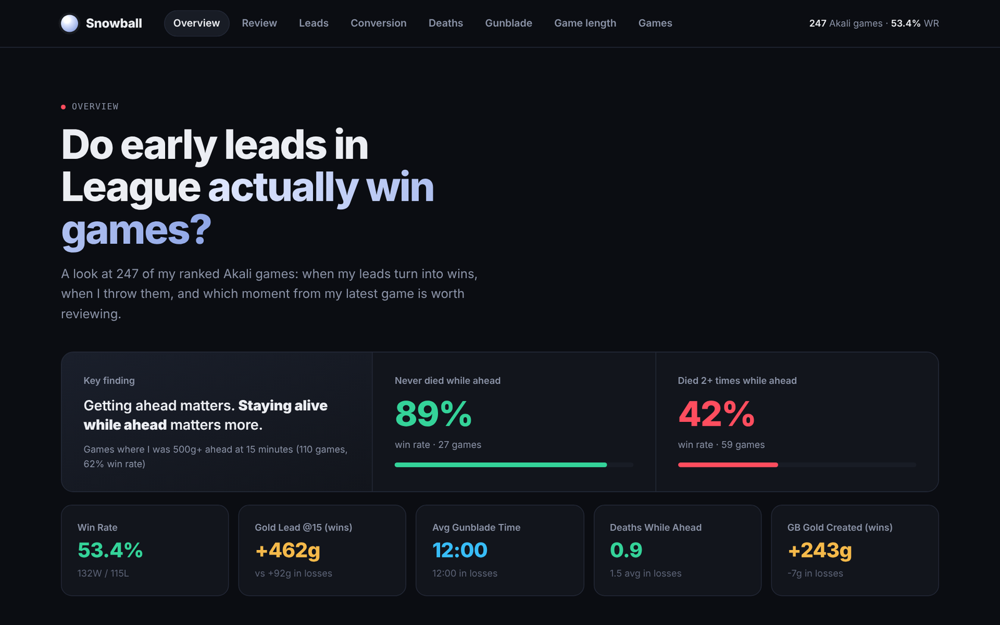

# Snowball

**Do early leads in League of Legends actually win games?**

Snowball is a Python pipeline and dashboard that pulls my ranked Akali games from the Riot Games API, tracks how far ahead or behind I was against the enemy mid laner over time, and looks at when early leads turn into wins and when they get thrown away.

👉 **[View the live dashboard](https://curruy123.github.io/finalportf/convert/)**



## Key finding

When I was 500g+ ahead at 15 minutes, I won **89%** of games where I never died while ahead, but only **42%** of games where I died twice or more while ahead. Getting ahead matters; staying alive while ahead matters more.

## Features

- **Review This Moment:** automatically finds the costliest death or lead swing in my most recent game and gives a replay window to jump to.
- **Lead trends:** gold and XP lead over the enemy mid laner, split by wins and losses.
- **Lead conversion:** win rate when ahead, even or behind at 10, 15 and 20 minutes.
- **Deaths while ahead:** when they happen and what they cost.

---

## What it does

1. **`pipeline.py`** pulls match and timeline data from the Riot API and builds features like gold, XP and CS leads at each minute.
2. **`model.py`** predicts wins from the game state at 15 minutes (gold, XP and CS leads, kills, deaths, assists). It compares a baseline, two logistic regressions and a random forest, using a time-ordered test set and time-series cross-validation, and ranks which stats matter most.
3. **`dashboard.py`** turns the results into a single interactive HTML dashboard (Chart.js).

The pipeline can scan as many recent ranked games as you want. Set `GAME_COUNT` in `.env` (default 300).

## What the dashboard shows

- **Lead decay curve:** average gold and XP lead over the enemy mid laner, split by wins and losses, to show when leads are created or lost.
- **Gunblade spike window:** how much lead was created in the 3 minutes after completing Hextech Gunblade.
- **Deaths while ahead:** how often I die while holding a 300+ gold lead. The "throwing leads" detector.
- **Win probability model:** how well the 15-minute game state predicts the result.
- **Game log:** per-game table of key stats.

## Run it yourself

```bash
pip install -r requirements.txt
cp .env.example .env      # then add your Riot API key and Name#TAG
python3 pipeline.py       # fetch games  →  data/processed.json
python3 model.py          # train model  →  models/
python3 dashboard.py      # build page   →  dashboard/index.html
open dashboard/index.html
```

Get a free development API key at [developer.riotgames.com](https://developer.riotgames.com). Dev keys expire every 24 hours. Fetching takes a while because of API rate limits.

## Notes on method

- Data: Riot Match API and Timeline API (one snapshot per minute).
- All leads are measured against the enemy mid laner.
- "Deaths while ahead" means dying while holding a lead of 300+ gold.
- This is one player's games, so findings are hypotheses about my own habits, not general conclusions.

## Project structure

```
snowball/
├── pipeline.py          # data fetching + feature engineering
├── model.py             # win probability model
├── dashboard.py         # HTML dashboard generator
├── requirements.txt
├── .env.example         # copy to .env and add your key
├── data/processed.json  # output of pipeline.py
├── models/              # output of model.py
└── dashboard/index.html # output of dashboard.py
```
